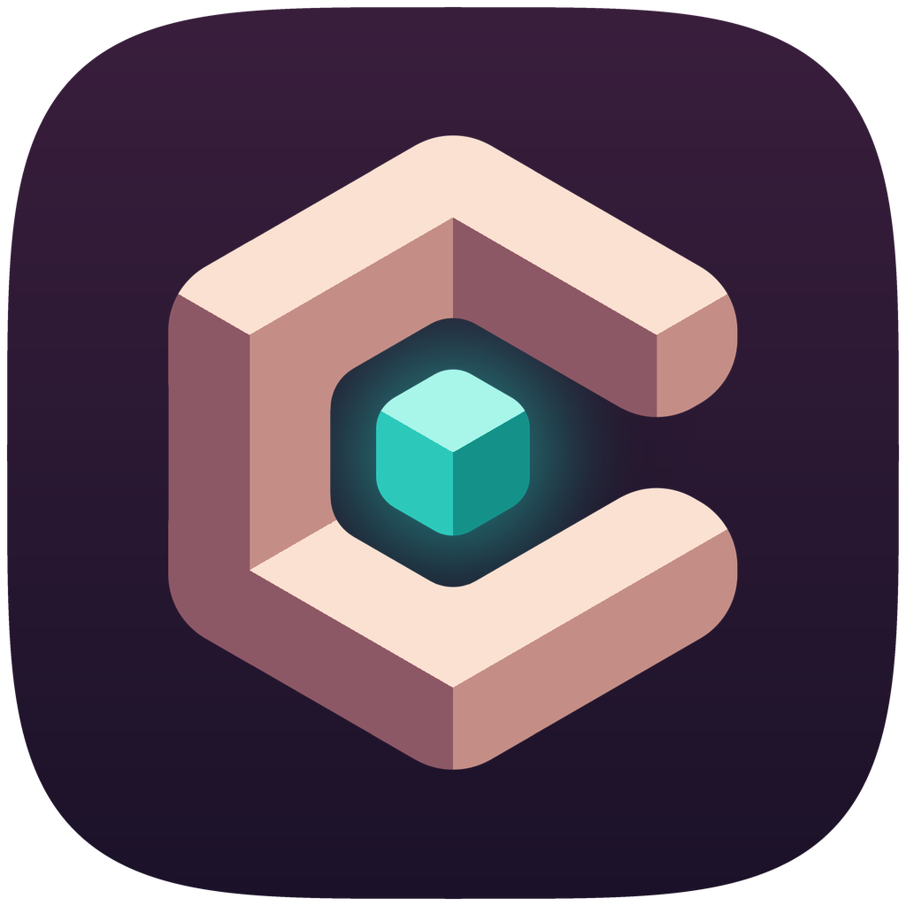

<p align="center"></p>

<p align="center">
  <a href="https://github.com/zernivo/Cove/releases/latest"><b>⬇ Download for Windows 11</b></a> ·
  <a href="docs/ROADMAP.md">Roadmap</a> ·
  <a href="docs/SAFETY.md">Safety</a> ·
  <a href="docs/VISION.md">Vision</a>
</p>

<p align="center">
  <a href="https://github.com/zernivo/Cove/actions/workflows/ci.yml"></a>
  <a href="https://github.com/zernivo/Cove/releases/latest"></a>
  
</p>

**Cove** gives Windows 11 a calm, Mac-inspired way of working: smooth, flexible and uncluttered. It keeps every Windows feature, hides the clutter, and teaches Mac habits like Alt+W to close and Alt+H to hide an app. Everything it changes can be undone in one click.

> **Status: early preview (v0.3).** Every feature is off until you switch it on, and **Back to stock** puts everything back.

---

## Contents
- [Download](#download)
- [What it does today](#what-it-does-today)
- [Mac shortcuts](#mac-shortcuts)
- [Cove Search](#cove-search)
- [Dock, top bar & Control Centre](#dock-top-bar--control-centre)
- [Safety](#safety)
- [Roadmap](#roadmap)
- [Build from source](#build-from-source)
- [Project docs](#project-docs)

## Download
1. Open the [latest release](https://github.com/zernivo/Cove/releases/latest).
2. Download **`Cove_<version>_x64-setup.exe`** (or the `.msi`).
3. Run it. The installer isn't code-signed yet, so SmartScreen may warn you: click **More info → Run anyway**.

Requires Windows 11 (x64). No admin rights needed to use Cove's features.

## What it does today
| Area | What you get |
|---|---|
| **Calm** | 7 toggles that hide Task View, the taskbar search box, Widgets, the Copilot button, Start's Recommended section, lock-screen tips, and tips & suggestions. |
| **Cove Search** | Alt+Space opens a launcher: every app (desktop and Store) with its real icon, files deep in your personal folders plus Windows Search index results (finds files by their contents too), Settings pages, quick actions and a calculator. It learns what you open most. Fully local. |
| **Cove Glass** | Two calm themes for everything Cove draws: Tidepool (warm, wallpaper-tinted glass) and Slate (quiet graphite). Light, dark or follow Windows, with the theme accent or your Windows accent. |
| **Clipboard history** | A Clipboard tab in Search with your last 50 text copies. Enter pastes, kept in memory only, and password-manager copies are skipped. |
| **Mac habits** | Five window shortcuts, opt-in, active only while Cove runs. |
| **Window snapping** | Opt-in Ctrl+Alt presets: halves (press again for ⅔ and ⅓), quarters, thirds, two-thirds, fill, centre, restore, and move to the next display. Windows glide into place in about 0.2 s. |
| **App Exposé** | Every window of one app as live previews: right-click a Dock icon → *Show All Windows*, or press ↓ in the app switcher. |
| **App switcher** | Opt-in Alt+Tab that shows one icon per app, Mac style, with a window count badge. Release Alt to switch. |
| **Cove Dock** | A floating dock with pinned and running apps, hover magnification, running dots, folder stacks (Downloads, Documents, Desktop, Pictures), Recycle Bin, and an optional auto-hiding Windows taskbar. |
| **Top bar** | A thin bar across the top: the app in front, a Cove menu, Wi-Fi, sound, battery and the clock. Windows make room for it. |
| **Control Centre** | From the top bar: sound and brightness sliders, mute, dark mode, Wi-Fi name, shortcuts to Bluetooth, Night light and Focus. |
| **Back to stock** | One click restores every setting Cove changed, exactly as it was. |
| **Updates** | One click: Cove downloads the update with a progress bar, checks its SHA-256, installs silently (no wizard), reopens and tells you it updated. |

## Mac shortcuts
Alt sits where Cmd does on a Mac keyboard.

| Shortcut | Mac equivalent | Does |
|---|---|---|
| `Alt+W` | Cmd+W | Close the current window |
| `Alt+M` | Cmd+M | Minimize the current window |
| `Alt+H` | Cmd+H | Hide every window of the current app |
| `Alt+Q` | Cmd+Q | Quit the app (closes each window politely, so you can still save) |
| ``Alt+` `` | Cmd+` | Jump between windows of the same app |

**App switcher (opt-in):** turn on *App switcher (Alt+Tab)* in **Mac habits**. Hold Alt and tap Tab to move through your apps (one icon each, most recent first), Shift+Tab or ← to go back, ↓ to see all of that app's windows (App Exposé), Esc to cancel, release Alt to switch. A quick Alt+Tab tap jumps straight to the previous app. It uses a standard Windows keyboard hook that's removed when you turn it off or quit Cove, and Windows' own Alt+Tab comes back.

**Window snapping:** turn on *Mac habits → Window snapping (Ctrl+Alt)*. Ctrl+Alt+←/→/↑/↓ snaps the front window to a half (press again for ⅔, then ⅓), U/I/J/K for quarters, D/F/G for thirds, E/T for two-thirds, Enter to fill, C to centre, Backspace to put it back, and Ctrl+Alt+Shift+←/→ to move it to another display. Moves glide over about 0.2 s and stop the moment you grab the window; turn *Glide into place* off (or Windows' Animation effects) for instant moves. Note: on keyboard layouts that use AltGr (Ctrl+Alt) for characters, the letter shortcuts may clash.

**App Exposé:** right-click any running app in the Dock and choose *Show All Windows*, or press ↓ while the app switcher is open. Cove dims the screen and shows a live preview of each window (minimized ones are listed underneath). Click one, or use the arrow keys and Enter, to bring it forward; Esc or a click on the background goes back. Previews use the same documented DWM thumbnails as the taskbar.

Cove remembers whether shortcuts are on. Closing the window keeps Cove in the system tray so shortcuts keep working; quit from the tray icon. Cove never acts on the desktop or taskbar, and marks any shortcut another app already uses as **In use**.

## Cove Search
Press **Alt+Space** anywhere.

| Key | Does |
|---|---|
| Type | Instant results as you type (apps first, then files, settings) |
| `↑` `↓` | Move |
| `Enter` | Open (on a sum: copy the answer) |
| `Ctrl+Enter` | Show a file in its folder |
| `Tab` | Switch tab: All, Apps, Files, Settings, Clipboard |
| `Ctrl+D` | Keep the selected app in the Dock |
| `Esc` | Clear, then close |

Try `blu` for Bluetooth, `vsc` for Visual Studio Code, or `128*4+7`. Results marked *Windows Search* come from the same read-only index as File Explorer's search box, so a word inside a document can find it; turn *Use the Windows Search index* off in **Mac habits** for name-only search of your personal folders. The same card shows how fast Search opens on your PC (Alt+Space to first frame). Turn it off in **Mac habits** if Alt+Space is taken (e.g. by PowerToys Run).

## Displays and scaling
Cove sizes the Dock, top bar, Search and the app switcher to each screen's own scaling, so they look the same at 100%, 150% or 200% and when they move between screens. If you unplug a screen, the Cove window comes back to your main display. **Dock & top bar → Your displays** lists each screen with its resolution and scaling, and updates live.

## Icon and installer
<p></p>

Cove's final icon is **Deep tide**: the Cove mark in warm light tones on a deep plum tile, with a glowing teal cube. The NSIS setup and the MSI installer use matching artwork. All of it is original and generated by `brand/final_art.py`.

## Tray
Cove keeps running in the notification area after you close its window. **Left-click** the icon to open Cove. **Right-click** for Search, quick on/off switches for the Dock, Top bar, Mac shortcuts, App switcher and Window snapping, an Appearance submenu (Follow Windows, Light, Dark), Take the tour, Check for updates, Restore… and Quit. The check marks always match Settings.

## Cove Tour
The first time Cove opens, a short tour starts. Pick a starting point:

- **Mac-like:** calm taskbar, Search, Mac shortcuts, dock, top bar, app switcher and window snapping.
- **Light touch:** calm taskbar and Search only.
- **Keep things as they are:** change nothing.

Then try each feature live (Alt+Space, Alt+M, Ctrl+Alt+←, Alt+Tab, ↓ in the switcher). Each step ticks itself off when you use it, and a feature that's off has a **Turn it on** button. Skip any step or the whole tour; replay it from **Take the tour** at the bottom of the sidebar. Everything it turns on is undone by Restore.

## Look (Cove Glass)
Open Cove → **Look**.

- **Theme:** *Tidepool* (default) is warm glass that lets your wallpaper's colour through, with a soft glow on the app in front. *Slate* is quiet and mostly solid, graphite with one blue focus colour.
- **Appearance:** Follow Windows, Light or Dark. This changes Cove's own windows only, never Windows' setting.
- **Accent colour:** the theme's own, or follow the accent chosen in Windows Settings → Personalization → Colors (read-only).

- **Wallpaper:** four original 4K scenes (Tidepool, Lagoon, Dune, Slate), each with a light and a dark version. The desktop switches version with Cove's appearance. **Restore my wallpaper** puts back the one you had before (Restore all does too).
- **Light & dark schedule:** switch Cove and its wallpaper to light and dark at set times (default 07:00 and 19:00). Picking Light or Dark yourself holds until the next switch.

Changes apply instantly to the dock, top bar, Control Centre, Search, the app switcher and App Exposé. With *Transparency effects* off in Windows, Cove uses solid surfaces. Wallpapers are set through Windows' documented wallpaper setting; the art is original and made by `brand/wallpapers.py`.

## Dock, top bar & Control Centre
Turn them on in Cove → **Dock & top bar**.

- **Dock:** click an app to open or switch to it, and click the app in front to minimise it. Right-click for **Keep in Dock**, **Remove from Dock** and **Close window**. Click a folder stack (Downloads by default) to see its newest files in a grid: click to open, Ctrl+click to show in its folder. Choose stacks under **Folder stacks**. With more than one screen, set **Dock appears on** to *Follows the pointer* and rest the pointer on any screen's bottom edge to move the dock there. The dock and top bar re-fit themselves when you plug in a screen or change its resolution or scaling. Turning on *Auto-hide the Windows taskbar* uses Windows' own setting and is undone when the dock goes off or Cove quits.
- **Top bar:** registered as a standard Windows app bar, so maximised windows sit below it. Click the Cove mark for the menu, or the app name to open Cove.
- **Control Centre:** click the sliders, Wi-Fi or sound icon in the top bar. Dark mode writes the same setting as Windows Settings → Personalization → Colors. The brightness slider shows only on screens Windows can dim (most laptops).

## Safety
- **Per-user only:** Cove writes documented settings under your own account (HKCU), never system-wide.
- **Journaled:** every change is saved with its previous value, so restore is exact.
- **Never:** system-file patching, code injected into Explorer, drivers, or disabling Defender or Windows Update.
- **No Apple assets:** no SF fonts, SF Symbols, wallpapers or traffic-light artwork.

Calm settings stay applied after you close Cove (like changing them in Settings) until you press **Back to stock**. Shortcuts stop the moment Cove closes. Full rules: [docs/SAFETY.md](docs/SAFETY.md).

## Roadmap
| Version | Milestone | Status |
|---|---|---|
| v0.1 | Calm preset, Mac shortcuts, restore, installer, updater | ✅ |
| v0.2 | Cove Search (Alt+Space) | ✅ |
| v0.3 | Dock, top bar, Control Centre, folder stacks, multi-display | ✅ |
| v0.4 | App-grouped switcher ✅, App Exposé ✅, window snapping ✅ | ✅ |
| v0.5 | Cove Glass theme, wallpaper gallery, light/dark schedule | ✅ |
| v0.6 | Cove Tour (interactive first-run tutorial) | ✅ |
| v0.7 | Polish: settings design, tray menu, final icon + installer art, DPI and multi-monitor pass | ✅ |
| 1.0 | Safe mode, code signing, auto-update, performance gates | ⬜ |

Details: [docs/ROADMAP.md](docs/ROADMAP.md)

## Build from source
Prerequisites: Windows 11, Rust (stable, MSVC), Node 20+, WebView2 runtime.
```bash
git clone https://github.com/zernivo/Cove.git
cd Cove
npm install
npm run tauri dev      # run in development
npm run tauri build    # build the installer
```
Stack: Rust core + Tauri 2 (WebView2), Mica for the main window. Budget: ~0% CPU idle, ~150 MB memory. See [docs/ARCHITECTURE.md](docs/ARCHITECTURE.md).

**Releasing:** push a tag such as `v0.1.0` and GitHub Actions builds and publishes the installer.

## Project docs
- [Vision & pillars](docs/VISION.md)
- [Roadmap](docs/ROADMAP.md)
- [Architecture](docs/ARCHITECTURE.md)
- [Safety rules](docs/SAFETY.md)
- [Research](docs/research)

## License
Not chosen yet. Until a license is added, all rights are reserved.
