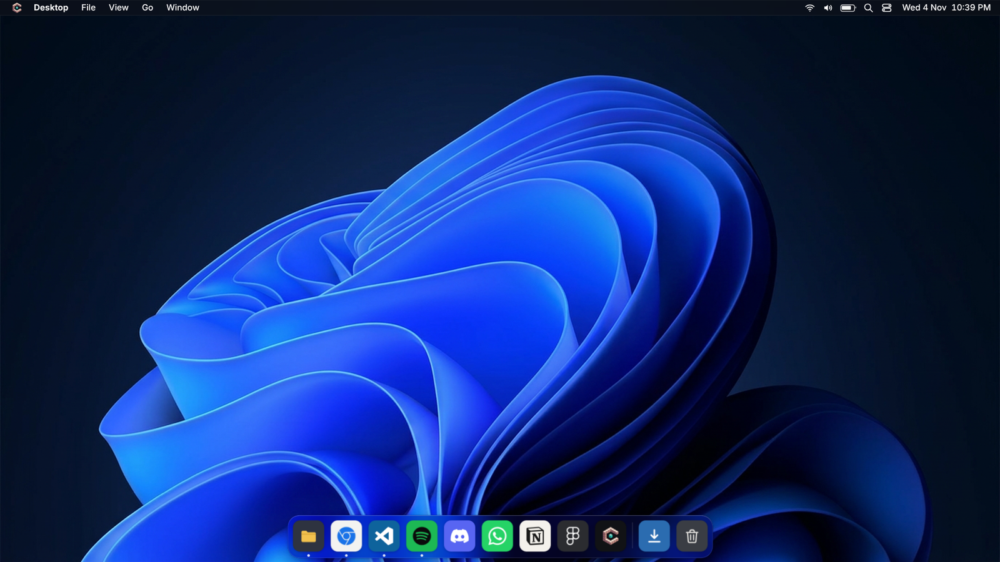
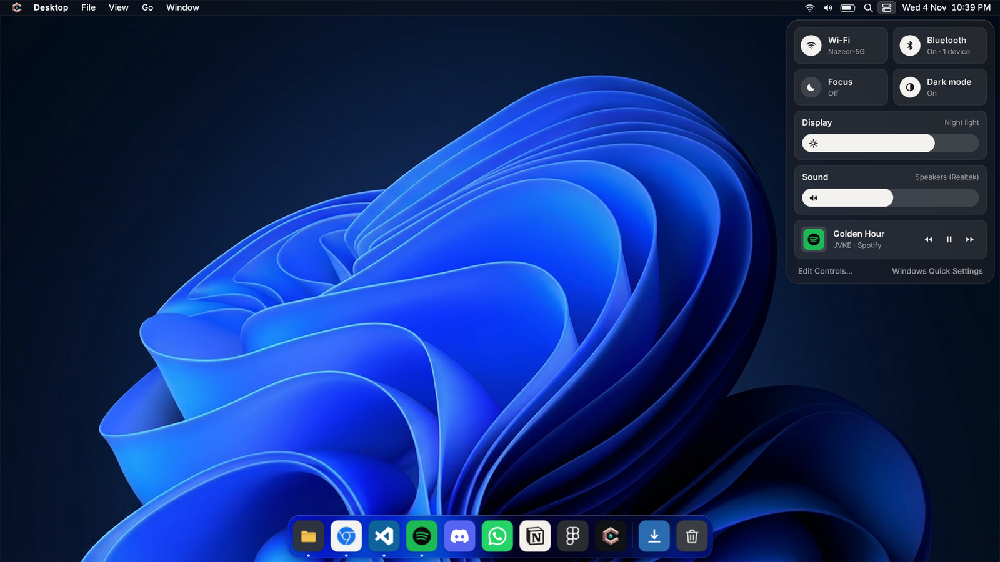
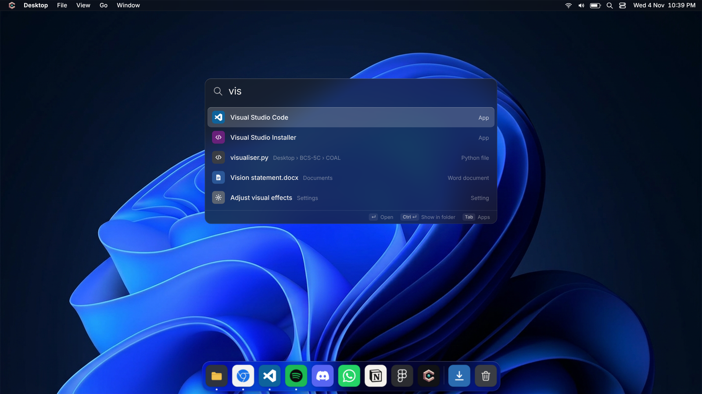

<h1 align="center">Cove</h1>
<p align="center"><b>Windows, made calm.</b></p>

<p align="center"></p>

<p align="center">
  <a href="https://github.com/zernivo/Cove/releases/latest"><b>Download for Windows 11</b></a> ·
  <a href="#safety">Safety</a> ·
  <a href="docs/ROADMAP.md">Roadmap</a> ·
  <a href="CONTRIBUTING.md">Contributing</a>
</p>

<p align="center">
  <a href="https://github.com/zernivo/Cove/actions/workflows/ci.yml"></a>
  <a href="https://github.com/zernivo/Cove/releases/latest"></a>
  
  <a href="LICENSE"></a>
</p>

Cove gives Windows 11 a calm, Mac-style desktop. A Liquid Glass dock replaces
the taskbar, Search opens with Alt+Space, Control Centre holds your quick
settings, and window buttons look like a Mac's when you hover. Every Windows
feature stays where it was. Turn Cove off and Windows comes back exactly as it
was, because Cove only uses documented per-user settings and records every
change it makes.

## Features (v0.9.0)

| | |
|---|---|
| **Dock with Liquid Glass** | Pinned and running apps with their real icons, gentle magnification, running dots, folder stacks, Recycle Bin and Mac-style motion. The glass is a blurred slice of your own wallpaper with a refracted edge. The dock hides when a window touches it and comes back at the bottom edge. |
| **Status island** | The right end of the dock holds Search, Wi-Fi, sound, battery, Control Centre and the clock, so nothing has to sit at the top of the screen. |
| **No top bar by default** | Maximised windows get the whole screen. Want a menu bar? Turn it on in Settings, either always shown or revealed at the top edge. Click the Cove icon in the dock for the Cove menu, or right-click a running app for its menu. |
| **Spotlight-style Search** | Alt+Space from anywhere: apps, files (including words inside documents, through Windows' own index), Settings pages, quick actions, a calculator and clipboard history. Fully local. |
| **Control Centre** | Volume, brightness, Wi-Fi, Bluetooth, Focus, dark mode, Night light and what's playing, in one glass panel. |
| **Tray icons in Control Centre** | The notification-area icons of your other apps, so nothing is lost without a taskbar. |
| **Mac window buttons on hover** | Close, minimise and zoom appear as Mac-style buttons when you hover a window's corner. Windows' own buttons are left untouched. |
| **App Exposé** | Every window of one app side by side: press ↓ in the switcher, or right-click an app in the dock and choose Show All Windows. |
| **App-grouped switcher** | Alt+Tab shows one icon per app, like a Mac. |
| **Snapping** | Ctrl+Alt presets for halves, thirds, quarters, two-thirds, centre and fill, and moving to another screen. Windows glide into place. |
| **Wallpaper gallery** | Cove's own art plus free-licence photos from Wikimedia Commons and NASA, each one credited, with a light and dark schedule. |
| **Intro** | A short "blocks settle" intro the first time Cove starts. Replay it from About. |
| **Mac shortcuts** | Alt+W closes, Alt+M minimises, Alt+H hides, Alt+Q quits and Alt+` cycles an app's windows. |
| **Quiet Windows** | Hide Task View, the search box, Copilot, Start's Recommended section, lock-screen tips and suggestions, one switch each. |
| **Safe mode** | Hold Shift while Cove starts (or run `Cove.exe --safe`) to pause everything without losing your settings. Cove also starts in safe mode by itself if it didn't start cleanly twice in a row. |
| **Fully reversible takeover** | Cove's desktop on hides the taskbar completely. Off, quitting, or Restore everything puts Windows back exactly. |
| **Signed updates** | One click. Cove checks each update's SHA-256 and its signature against Cove's own update key before installing. |

<p align="center">
  
  
</p>

## Install

1. Open the [latest release](https://github.com/zernivo/Cove/releases/latest).
2. Download **`Cove_<version>_x64-setup.exe`**.
3. Run it. It installs for your account only, with no admin rights.

The installer is not code-signed yet, so SmartScreen may warn you. Click
**More info**, then **Run anyway**. Code signing is planned, and a winget
package will follow it (draft in [`packaging/winget`](packaging/winget)).

Requires Windows 11 (x64).

## Safety

These are promises, not goals. A change that breaks one doesn't get merged.

- **No injection, no patching.** Cove never injects code into Explorer or any
  other process, never patches system files or themes, and installs no drivers.
- **Documented, per-user settings only.** Cove changes what Windows Settings
  itself can change, for your account only. If something can't be changed
  safely, Cove opens the right Settings page instead.
- **Every change is journaled** with its previous value, so Restore is exact.
- **Fully reversible.** Turning Cove's desktop off, quitting, or **Restore
  everything** puts Windows back the way it was.
- **Hands off protections.** Defender, SmartScreen, UAC and Windows Update are
  never touched.
- **Private.** No account and no telemetry. Cove only goes online for the
  wallpaper gallery and update checks.
- **No Apple assets.** No Apple fonts, symbols, wallpapers or artwork.

Full rules: [docs/SAFETY.md](docs/SAFETY.md).

## Building

Prerequisites: Windows 11, Rust stable (MSVC), Node 20+, WebView2 (built into Windows 11).

```bash
git clone https://github.com/zernivo/Cove.git
cd Cove
npm install
npm run tauri dev      # run from source
npm run tauri build    # build the installer
```

Before pushing, run `bash notes/windows-check.sh`, `npx tsc --noEmit` and
`npx vite build`. CI also enforces a UI bundle size budget. Everything else
(previews, design rules, safety rules) is in [CONTRIBUTING.md](CONTRIBUTING.md).

Stack: a Rust core on Tauri 2 (WebView2) with a TypeScript UI. See
[docs/ARCHITECTURE.md](docs/ARCHITECTURE.md).

## Project docs

- [Vision](docs/VISION.md) · [Roadmap](docs/ROADMAP.md) · [Architecture](docs/ARCHITECTURE.md) · [Safety](docs/SAFETY.md)
- [Glass and Apple design guide](docs/design/GLASS_AND_APPLE_GUIDE.md)
- [Changelog](CHANGELOG.md) · [Third-party notices](THIRD_PARTY_NOTICES.md)

## Licence

[MIT](LICENSE) © 2026 Khubaib Nazeer (zernivo). Cove builds on open-source
software listed in [THIRD_PARTY_NOTICES.md](THIRD_PARTY_NOTICES.md).
Cove is not affiliated with Apple or Microsoft.
